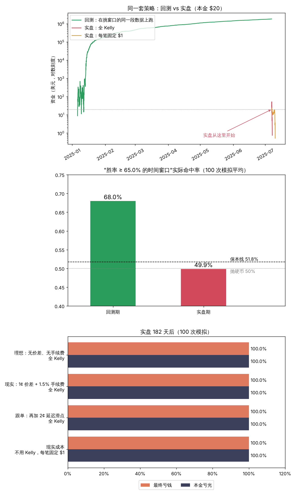

# Polymarket "BTC 5 分钟涨跌" 策略模拟器

把推文里"让 Claude 写的自动交易策略"原样复刻一遍，看看它在**没见过的数据**上会怎样。
纯模拟，不连接任何交易所或钱包，不碰真钱。



## 复刻的四条"策略"

| 推文原话 | 程序里怎么做 |
|---|---|
| 1. 时间偏差：找胜率 > 65% 的时间窗口 | 一周切成 2016 个 5 分钟窗口（星期几 × 时刻），在训练期里挑出"涨"或"跌"的比例 ≥ 65% 的窗口 |
| 2. Kelly 资金管理 | 每笔下注本金的 f* = (p·b − q) / b，默认全 Kelly |
| 3. 波动率过滤 | 开盘前 30 分钟的波动率超过训练期第 70 百分位就跳过 |
| 4. 贝叶斯更新 | 每个窗口的胜率 p 用 Beta 分布估计，每出一个结果就更新一次 |

交易成本：
- 每份合约的公平价是 0.50 美元，押对拿回 1 美元，押错归零。
- 现实场景：加 1¢ 价差和约 1.5% 手续费。手续费是近似值，可以在代码里改，实际费率以官方为准。
- 跟单场景：再加 2¢ 的延迟滑点。
- 单笔最多 1000 美元，因为 5 分钟市场的盘口有限。

## 默认结果（模拟 BTC 价格，100 次）

数据是前 26 周训练（挑窗口），后 26 周实盘，本金 20 美元：

- 训练期平均挑出约 **339 个"胜率 ≥ 65%"的窗口**，回测命中率 **68%**，回测资金从 20 美元涨到 **约 190 万美元**（中位数）。这就是推文里那种截图。
- 同样这些窗口，到了实盘期命中率 **49.9%**，就是抛硬币。
- 实盘 4 个场景（理想、现实、跟单、每笔固定 $1）**100 次模拟全部亏光**：
  - 全 Kelly 平均约 50 笔就亏光。
  - 每笔固定 1 美元也只多撑了约 530 笔。

完整数字见 `results/summary.txt`。

### 为什么会这样

- 2016 个窗口，每个只有 26 个样本。纯靠运气，就会有十几个百分比的窗口"看起来"有 65% 以上的胜率。这叫**多重比较 / 过拟合**：挑得越多，越容易挑到"假规律"。
- 模拟数据的涨跌方向**按构造就是随机的**，所以这些"规律"一个都不是真的。挑出来的窗口在新数据上回到 50%，正好说明了这一点。
- Kelly 公式的前提是 p 估得准。用高估的 p（约 64%）去下全 Kelly，每笔押掉本金的约 25%，没有优势时亏得极快。
- 即使不用 Kelly，价差加手续费也让保本线变成 51.8%，跟单是 53.8%。命中率只有 50%，必然慢慢亏光。

## 运行

```bash
pip install numpy pandas matplotlib
python3 simulate.py                  # 默认：模拟数据，100 次，约 1 分钟
python3 simulate.py --runs 20        # 快一点
python3 simulate.py --kelly 0.5      # 半 Kelly
python3 simulate.py --threshold 0.7  # 门槛改成 70%
python3 simulate.py --help           # 全部参数
```

### 用真实 BTC 数据

从 Binance 公开数据站下载 1 分钟 K 线，建议至少 6 个月，比如：

```
https://data.binance.vision/data/spot/monthly/klines/BTCUSDT/1m/BTCUSDT-1m-2026-01.zip
https://data.binance.vision/data/spot/monthly/klines/BTCUSDT/1m/BTCUSDT-1m-2026-02.zip
...
```

解压到 `data/` 目录，然后：

```bash
python3 simulate.py --csv 'data/BTCUSDT-1m-*.csv' --train-days 90
```

用真实数据只跑一次，没有蒙特卡洛。真实 BTC 的短线方向同样接近随机，结果不会有本质区别，可以自己验证。

## 局限

- Polymarket 的 BTC 涨跌市场用的是预言机价格，这里用的是交易所收盘价，两者略有差别。
- 假设每次都能以 0.50 附近成交。实际开盘价格会随市场情绪偏离，盘口深度也有限。
- 只模拟了推文描述的这一种"策略"。它说明不了所有策略都不行，但足以说明**回测曲线漂亮不等于能赚钱**。
